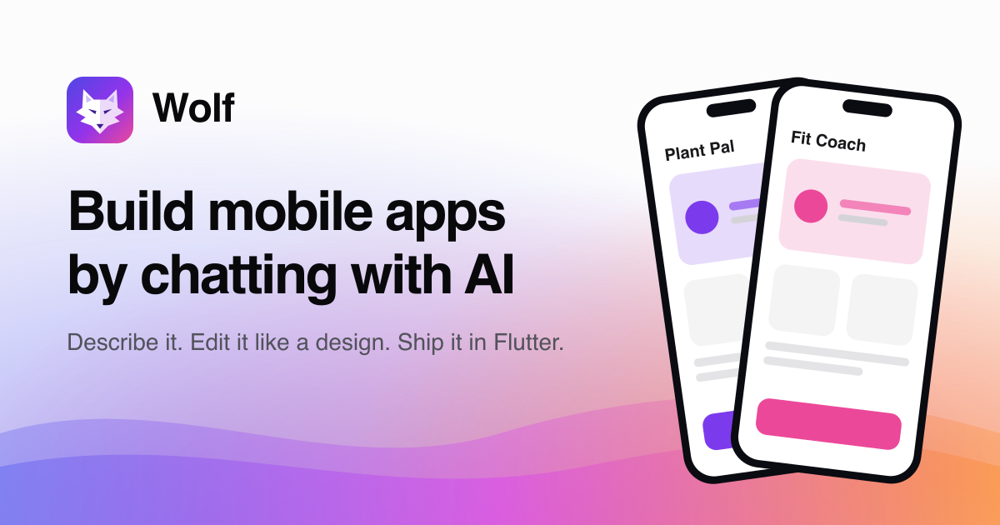
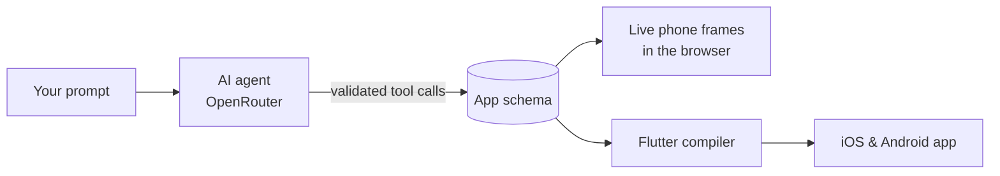

<div align="center">


# Wolf

**Build mobile apps by chatting with AI.**

Describe your idea. Wolf designs every screen, lets you refine it like a design file,<br />
and compiles it to a real Flutter app for iOS and Android.

[](LICENSE)




</div>

---

## ✨ What it does

- **Prompt to app.** Type one sentence and watch Wolf plan the screens, theme, data and navigation,
  then build them live on phone frames.
- **Refine by pointing.** Click any element on a screen and tell Wolf what to change. Every AI change
  is listed and can be rolled back.
- **Real Flutter output.** The app compiles to clean, idiomatic Flutter (Material 3) that passes
  `flutter analyze`, with typed data models and optional Supabase, Firebase or REST repositories.
- **Any model.** The AI runs through [OpenRouter](https://openrouter.ai), so you choose the model.

> **Early development.** Prompting, live generation, refining and rollback work today. Direct
> visual editing, connecting a database from the UI, and one-click builds are next.

## 🧭 How it works



Every Wolf app is a single JSON **schema**: screens, components, theme, data models and navigation.
The AI edits it only through validated tools, the browser renders it as Material 3 phone frames, and
the compiler turns the same schema into a Flutter project.

## 📦 Repository layout

| Path | What's inside |
|------|---------------|
| [`backend/`](backend) | FastAPI service: auth, projects, the AI agent, builds, waitlist |
| [`backend/packages/flutter-codegen`](backend/packages/flutter-codegen) | Schema → Flutter project compiler |
| [`web/`](web) | React + Vite app: landing page, projects, chat + canvas workspace |
| [`web/packages/schema`](web/packages/schema) | The app schema: types, component catalog, tree helpers |

The backend and the web app are independent and can be deployed separately.

## 🚀 Quick start

**You'll need:** Node 20+, [uv](https://docs.astral.sh/uv/), an [OpenRouter](https://openrouter.ai/keys)
API key and a [Firebase](https://console.firebase.google.com/) project.
The [Flutter SDK](https://docs.flutter.dev/get-started/install) is optional (for building apps).

**1. Set up Firebase sign-in.** In your Firebase project, enable **GitHub** and **Google** under
Authentication → Sign-in method, then add a **Web app** (Project settings → Your apps) to get its config.

**2. Run the backend.**

```bash
cd backend
cp .env.example .env   # add OPENROUTER_API_KEY and FIREBASE_PROJECT_ID
uv sync
uv run uvicorn wolf_api.main:app --reload --port 8000
```

**3. Run the web app.**

```bash
cd web
cp .env.example .env   # add the Firebase web config and set ALLOW_AUTH=true
npm install
npm run dev            # → http://localhost:5173
```

The dev server forwards `/api` to the backend. If port 8000 is taken, start the backend elsewhere and
run `WOLF_API_PORT=8010 npm run dev`.

## ⚙️ Configuration

<details>
<summary><b>Backend</b> (<code>backend/.env</code>)</summary>

| Variable | Required | Description |
|----------|:--------:|-------------|
| `OPENROUTER_API_KEY` | ✅ | Your OpenRouter key |
| `FIREBASE_PROJECT_ID` | ✅ | Used to verify sign-ins |
| `WOLF_MODEL` | | Any tool-capable OpenRouter model. Default `anthropic/claude-opus-5.5` |
| `WOLF_CORS_ORIGINS` | | Comma-separated web app origins. Default `http://localhost:5173` |
| `WOLF_ACCESS_MODE` | | `open` (default) or `waitlist`, which only lets in `WOLF_ALLOWED_EMAILS` |
| `WOLF_ALLOWED_EMAILS` | | Comma-separated emails allowed to sign in during the waitlist |
| `WOLF_DAILY_GENERATION_LIMIT` | | AI requests per user per 24 hours. Default `30`, `0` for unlimited |
| `FIREBASE_STORAGE_BUCKET` | | Store build files in Firebase Storage (otherwise kept on disk) |
| `FIREBASE_SERVICE_ACCOUNT` | | Service account JSON (raw or base64), needed for Storage and backups |
| `LITESTREAM_BUCKET` | | Continuously back up the database to this bucket (Docker only) |
| `WOLF_DATA_DIR` | | Where the SQLite database lives. Default `backend/data` |

</details>

<details>
<summary><b>Web</b> (<code>web/.env</code>)</summary>

| Variable | Description |
|----------|-------------|
| `ALLOW_AUTH` | `true` shows **Log in / Get started**. Unset or anything else shows **Join waitlist** |
| `API_URL` | The backend URL. Leave empty in development |
| `FIREBASE_API_KEY`, `FIREBASE_AUTH_DOMAIN`, `FIREBASE_PROJECT_ID`, `FIREBASE_APP_ID` | Your Firebase web config (public values) |
| `SITE_URL` | Your site's public URL, for social preview images |

</details>

## 🌍 Deploying

Wolf runs on **Railway** (backend + SQLite) and **Vercel** (web), with **Firebase** for sign-in and files.

<details>
<summary><b>Backend on Railway</b></summary>

1. Create a service from this repo with **Root Directory** `backend`. It builds from
   `backend/Dockerfile` using `backend/railway.json`.
2. Add a **volume** mounted at `/data`.
3. Set the variables: `OPENROUTER_API_KEY`, `FIREBASE_PROJECT_ID`, `WOLF_CORS_ORIGINS` (your Vercel
   URL) and, until launch, `WOLF_ACCESS_MODE=waitlist` with `WOLF_ALLOWED_EMAILS`.
4. Optional: `FIREBASE_STORAGE_BUCKET` + `FIREBASE_SERVICE_ACCOUNT` for file storage, and
   `LITESTREAM_BUCKET` (same bucket) for continuous database backups.
5. Generate a public domain.

</details>

<details>
<summary><b>Web on Vercel</b></summary>

1. Import the repo with **Root Directory** `web`. Settings come from `web/vercel.json`.
2. Add the `FIREBASE_*` values, `API_URL` (your Railway URL) and `SITE_URL`.
   Leave `ALLOW_AUTH` unset to show the waitlist.
3. In Firebase → Authentication → Settings → **Authorized domains**, add your Vercel domain.
4. Turn on **Analytics** in the Vercel project (Analytics tab → Enable). The app already includes
   Vercel Web Analytics; it records page views without cookies and replaces project ids in URLs
   with `/p/[id]`.

</details>

<details>
<summary><b>Waitlist</b></summary>

Before launch, the site shows **Join waitlist** instead of sign-in (`ALLOW_AUTH` unset), and the
backend refuses everyone except `WOLF_ALLOWED_EMAILS` (`WOLF_ACCESS_MODE=waitlist`), so access is
enforced on the server, not just hidden in the page. Signups are stored with the idea people typed.
Export them from Railway:

```bash
railway ssh -- python -c "import csv,sqlite3,sys; w=csv.writer(sys.stdout); w.writerow(['email','idea','created_at']); w.writerows(sqlite3.connect('/data/wolf.db').execute('select email, idea, created_at from waitlist'))"
```

To launch, set `ALLOW_AUTH=true` on Vercel and `WOLF_ACCESS_MODE=open` on Railway.

</details>

## 🧪 Development

| Where | Command | What it does |
|-------|---------|--------------|
| `backend/` | `uv run pytest` | API and compiler tests (runs `flutter analyze` on generated apps if Flutter is installed) |
| `web/` | `npm test` | Schema package tests |
| `web/` | `npm run typecheck` | Type-checks the app and the schema package |
| `web/` | `npm run assets` | Regenerates the favicons and social image from `public/logo.svg` |
| `web/` | `UPDATE_CATALOG=1 npm test` | Re-exports the component catalog to the backend after changing it |

## 🤝 Contributing

Contributions are welcome. See [CONTRIBUTING.md](CONTRIBUTING.md) for guidelines.

## 📄 License

[MIT](LICENSE) © Odinachi David and Wolf contributors
